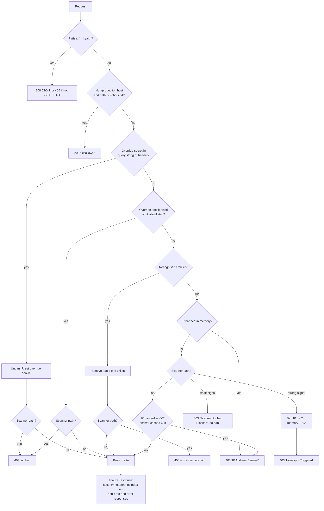

# cloudflare-edge-honeypot

A small, dependency-free middleware for **Cloudflare Pages Functions** and **Cloudflare Workers** that turns the paths vulnerability scanners probe for (`/.env`, `/wp-login.php`, `/.git/config`, `/service-account.json`, ...) into a trap. A client that requests one of those paths is refused and its IP address is banned for 24 hours, in the isolate's memory and in a Workers KV namespace, so the ban follows it to every site that shares the namespace.

The same middleware also provides:

- an **owner override** so you can never lock yourself out of your own site,
- an exemption for **search engine and social preview crawlers** so a ban never damages SEO,
- a **`/__health`** endpoint for uptime monitors,
- automatic **`noindex`** on staging and preview hostnames,
- optional default **security headers** on every response.

It is one ES module ([src/index.js](src/index.js)), has no runtime dependencies, and needs no build step.

---

## Contents

- [Why we use it](#why-we-use-it)
- [How it works](#how-it-works)
- [Installation](#installation)
- [Cloudflare configuration](#cloudflare-configuration)
- [Usage](#usage)
- [Factory options](#factory-options)
- [What counts as a scanner path](#what-counts-as-a-scanner-path)
- [Owner override](#owner-override)
- [Crawler handling](#crawler-handling)
- [Staging and preview hosts](#staging-and-preview-hosts)
- [Health endpoint](#health-endpoint)
- [API reference](#api-reference)
- [Operations](#operations)
- [Testing](#testing)
- [Known limitations](#known-limitations)
- [Releasing changes](#releasing-changes)
- [License](#license)

---

## Why we use it

Every public website is crawled continuously by bots looking for leaked credentials and unpatched CMS installs. Our sites are static sites on Cloudflare Pages: they have no WordPress, no PHP, no `.env` file and no admin panel, so **a request for one of those paths is never legitimate traffic**. That makes the probe itself a reliable signal, and lets us act on the first request instead of waiting for a rate limit to trip.

We use this module, rather than leaving it to the platform, for four reasons:

1. **It stops the scan early.** A scanner typically walks a list of hundreds of paths. Banning on the first hit means the rest of the list gets a 403 from the edge instead of reaching Pages Functions logic, asset lookups, or any API routes behind them.
2. **One ban can cover every site.** Sites that bind the same KV namespace share a ban table, so a scanner caught on one domain is already banned when it moves to the next. A site with no `SECURITY_BANS` binding still works, but its bans live only in memory and are not shared.
3. **It is free and plan-independent.** Cloudflare's managed WAF rules and Bot Management are paid features. This runs on the free Workers/Pages tier with a single KV namespace.
4. **One implementation instead of several.** Several sites need identical protection. Keeping the logic in one repository, rather than a copy in each site's `functions/_middleware.js`, means a new scanner signature or a bug fix is written and tested once.

The staging `noindex` and `/__health` features live here for the same reason: every site needs them, and they belong in the same middleware slot.

---

## How it works

Each request passes through these checks in order. The first one that matches decides the outcome.



Points worth knowing:

- **Scanner paths are always refused**, even for the owner and for crawlers. The owner and crawlers are simply not banned for requesting them.
- **Strong and weak signals.** A path no static site could serve (`/.env`, `/wp-login.php`) bans on the first request. A path that is suspicious but plausible in a mistyped link (`/admin`, `/notes.old`) is refused without a ban. See [What counts as a scanner path](#what-counts-as-a-scanner-path).
- **Two ban stores.** `bannedIps` is a `Map` in the isolate's memory, capped at 10,000 entries. It is fast but local to one isolate and lost when the isolate is recycled. The KV namespace is the durable, shared copy. A KV hit is copied into memory so later requests in that isolate skip the KV read.
- **KV is used sparingly.** The checks run cheapest first: memory, then the path itself, and KV only for a request that would otherwise be let through. A "not banned" answer from KV is remembered per IP for 60 seconds, so a visitor loading a page and its assets costs one KV read, not one per request. A probe costs no reads at all.
- **Bans expire on their own.** KV entries are written with a 24-hour `expirationTtl`; memory entries carry an expiry timestamp that is checked on read.
- **KV failures fail open.** If the KV binding is missing or a KV call throws, the request is treated as not banned and the site keeps working.
- **KV is eventually consistent.** A new ban is immediate in the isolate that issued it and can take up to about a minute to be visible in other Cloudflare locations.

### KV record format

Key: `ban:<ip>` (lower-cased). Value:

```json
{ "ip": "198.51.100.77", "path": "/.env", "bannedAt": 1762819200000, "expiresAt": 1762905600000 }
```

`path` is the probe that triggered the ban, which makes the namespace a simple log of what scanners are looking for.

---

## Installation

### As a git submodule (how our sites use it)

Cloudflare Pages bundles everything under `functions/`, so the module is vendored there as a submodule and imported by relative path. No `npm install` is needed at build time.

```bash
git submodule add https://github.com/cbrothers/cloudflare-edge-honeypot.git functions/honeypot
```

```bash
git commit -m "Add cloudflare-edge-honeypot submodule"
```

When cloning a site that already has the submodule:

```bash
git submodule update --init --recursive
```

Cloudflare Pages checks out submodules automatically during a Git-connected build. If you deploy with `wrangler pages deploy` from your machine, run the command above first so `functions/honeypot/` is populated.

### As an npm dependency

For Workers projects, or Pages projects that bundle from `node_modules`:

```json
{
  "dependencies": {
    "cloudflare-edge-honeypot": "github:cbrothers/cloudflare-edge-honeypot#v1.0.0"
  }
}
```

Pin a tag or commit rather than `#main`, so a site only picks up a change when you choose to upgrade it.

---

## Cloudflare configuration

All bindings are optional. Without any of them the module still blocks scanner paths and keeps in-memory bans; you only lose durability, sharing across sites, and the override.

| Binding | Type | Purpose |
|:--|:--|:--|
| `SECURITY_BANS` | KV namespace | Durable, shared ban table. Bind the **same namespace** on every site to share bans between them. |
| `STUDIO_OVERRIDE_KEY` | Secret | The owner override secret. Use a long random value. If unset, the override is disabled. |
| `ALLOWLIST_IPS` | Variable | Comma-separated list of exact IP addresses that are never banned (for example your home WAN address). No CIDR ranges. |

Create the namespace once:

```bash
npx wrangler kv namespace create SECURITY_BANS
```

Bind it in `wrangler.jsonc` (or in the Pages project settings under **Settings → Bindings**):

```jsonc
{
  "kv_namespaces": [
    { "binding": "SECURITY_BANS", "id": "<namespace-id>" }
  ]
}
```

Set the override secret:

```bash
npx wrangler pages secret put STUDIO_OVERRIDE_KEY --project-name <pages-project>
```

---

## Usage

### Cloudflare Pages (`functions/_middleware.js`)

```javascript
import { createEdgeHoneypotMiddleware } from './honeypot/src/index.js';

export const { onRequest } = createEdgeHoneypotMiddleware({
    apexHostname: 'brothersblues.com',
    wwwHostname: 'www.brothersblues.com',
    overrideCookieName: '__bb_studio_override',
    tokenPrefix: 'bb_ovr'
});
```

That is the whole integration. Every request to the site, static assets included, now passes through the honeypot.

### With allowed paths and security headers

```javascript
import { createEdgeHoneypotMiddleware } from './honeypot/src/index.js';

export const { onRequest } = createEdgeHoneypotMiddleware({
    apexHostname: 'example.com',
    wwwHostname: 'www.example.com',
    // Paths that look like probes but are real on this site. Lower-case, exact match.
    allowPaths: new Set(['/admin', '/api/config.yml']),
    // Added to every response unless the response already sets that header.
    securityHeaders: {
        'X-Content-Type-Options': 'nosniff',
        'X-Frame-Options': 'DENY',
        'Referrer-Policy': 'strict-origin-when-cross-origin',
        'Strict-Transport-Security': 'max-age=31536000; includeSubDomains'
    }
});
```

### Chaining with your own middleware

Pages accepts an array of handlers. Put the honeypot first so banned clients never reach your code:

```javascript
const honeypot = createEdgeHoneypotMiddleware({ apexHostname: 'example.com' });

async function myMiddleware(context) {
    const response = await context.next();
    // ...
    return response;
}

export const onRequest = [honeypot.onRequest, myMiddleware];
```

### Cloudflare Workers

`onRequest` takes a Pages-style context object. In a Worker, build one in your `fetch` handler:

```javascript
import { createEdgeHoneypotMiddleware } from 'cloudflare-edge-honeypot';

const { onRequest } = createEdgeHoneypotMiddleware({ apexHostname: 'example.com' });

export default {
    async fetch(request, env, ctx) {
        return onRequest({
            request,
            env,
            next: () => env.ASSETS.fetch(request) // or your own handler
        });
    }
};
```

### Using only the decision logic

If you already have middleware and only want the verdict, call `evaluateHoneypotRequest` directly:

```javascript
import { evaluateHoneypotRequest } from './honeypot/src/index.js';

export async function onRequest(context) {
    const url = new URL(context.request.url);
    const { blockedResponse, setCookieHeader } = await evaluateHoneypotRequest({
        request: context.request,
        url,
        env: context.env
    });
    if (blockedResponse) return blockedResponse;

    const response = await context.next();
    if (!setCookieHeader) return response;

    // The owner just supplied the override secret: attach the cookie.
    const headers = new Headers(response.headers);
    headers.append('Set-Cookie', setCookieHeader);
    return new Response(response.body, { status: response.status, headers });
}
```

---

## Factory options

`createEdgeHoneypotMiddleware(options)` returns `{ onRequest, finalizeResponse }`.

| Option | Type | Default | Description |
|:--|:--|:--|:--|
| `apexHostname` | `string` | none | Production apex hostname, for example `example.com`. |
| `wwwHostname` | `string` | none | Production `www` hostname. |
| `overrideCookieName` | `string` | `__studio_override` | Name of the owner override cookie. Use a distinct name per site. |
| `tokenPrefix` | `string` | `eg_ovr` | Prefix of the derived cookie token. A distinct prefix per site means a cookie from one site is not valid on another, even when they share a secret. |
| `allowPaths` | `Set<string>` or `string[]` | `null` | Paths exempt from scanner detection. Compared against the decoded, lower-cased path, with and without a trailing slash. Exact match only, no prefixes or wildcards. |
| `securityHeaders` | `object` | `null` | Header name to value. Each is added to every response that does not already set it. |

Any hostname other than `apexHostname` and `wwwHostname` is treated as non-production. If neither is supplied, the staging features are switched off.

---

## What counts as a scanner path

`classifyScannerPath(pathname)` returns `'strong'`, `'weak'` or `null`; `isScannerPath(pathname)` returns `true` for either signal.

The path is first normalised: it is percent-decoded (twice, to catch double encoding), backslashes become forward slashes, repeated slashes are collapsed, and the result is lower-cased. A malformed escape such as the `%` in `/sale-50%-off` is left as it is, and the rest of the path is still decoded and checked.

**Never a probe:** `/`, `/index.html`, `/__health`, `/robots.txt`, `/sitemap.xml`, `/favicon.ico`, `/favicon.svg`, `/favicon.png`, `/apple-touch-icon.png`, anything under `/cdn-cgi/`, and anything in `allowPaths`.

**Strong signals: refused, and the IP is banned for 24 hours.**

| Rule | Examples caught |
|:--|:--|
| A `..` path segment, or a NUL byte | `/static/..%2f..%2fetc/passwd` |
| Sensitive dotfile or dot-directory as a path segment: `.env`, `.git`, `.aws`, `.ssh`, `.docker`, `.vscode`, `.ds_store` | `/.env`, `/.env.production`, `/.git/config`, `/app/.aws/credentials` |
| A known scanner segment (list below), when followed by end of path, `/`, `.`, `-` or `_` | `/wp-admin/install.php`, `/firebase-adminsdk-fbsvc.json` |
| A server-side file extension: `.php` (and `.php5` etc.), `.phtml`, `.asp`, `.aspx`, `.jsp`, `.jspx`, `.cgi`, `.env`, `.sql`, `.swp` | `/images/cache.php`, `/backup.sql` |

**Weak signals: refused with 403, but no ban.**

| Rule | Examples caught |
|:--|:--|
| `/admin` as a whole path segment | `/admin`, `/admin/reports` (not `/admin-guide` or `/blog/admin.html`) |
| A backup or config file extension: `.bak`, `.old`, `.orig`, `.ini`, `.conf`, `.yml`, `.yaml`, `.properties` | `/docs/setup.yml`, `/downloads/notes.old` |

Strong rules are checked first, so `/admin/index.php` and `/config/secrets.yml` still ban.

Strong scanner segments (`SCANNER_SEGMENTS`):

| Category | Segments |
|:--|:--|
| WordPress | `/wp-admin`, `/wp-login`, `/wp-content`, `/wp-includes`, `/wp-config`, `/wp-json`, `/xmlrpc.php`, `/wlwmanifest.xml` |
| Database admin | `/phpmyadmin`, `/pma`, `/myadmin` |
| Framework and server internals | `/vendor/phpunit`, `/cgi-bin`, `/actuator`, `/server-status`, `/telescope/requests`, `/_ignition/execute-solution`, `/next.config.js`, `/application-prod.properties` |
| Cloud credentials | `/service-account.json`, `/firebase-adminsdk`, `/gcp-credentials.json`, `/s3_config.json`, `/secrets.json`, `/secrets.yml` |
| Generic | `/autodiscover/autodiscover.xml` |

These rules assume a static site with none of these technologies. **If your site really serves a path that matches, add it to `allowPaths` before deploying**, or visitors to that path will be refused, and banned if the match is a strong signal.

---

## Owner override

The override exists so that the site owner can clear a ban on their own IP (for example after testing the honeypot) and stay exempt afterwards.

1. Set the `STUDIO_OVERRIDE_KEY` secret.
2. Visit any page with the secret, either as a query parameter or a header:

   ```text
   https://www.example.com/?studio_override=<secret>
   ```

   ```bash
   curl -H "x-studio-override: <secret>" https://www.example.com/
   ```

3. The middleware removes any ban on your IP (memory and KV) and sets an `HttpOnly; Secure; SameSite=Lax` cookie valid for 30 days. The response carrying the cookie is marked `Cache-Control: private, no-store`.
4. While the cookie is present, your requests skip the ban check and can never trigger a ban.

The cookie does not contain the secret. It holds a token derived from the secret and the site's `tokenPrefix`, so rotating `STUDIO_OVERRIDE_KEY` invalidates every existing cookie. Comparisons against the secret are constant-time.

`ALLOWLIST_IPS` gives the same exemption by IP address, with no cookie needed.

Prefer the header form where you can: a secret in a query string ends up in browser history and can appear in logs.

---

## Crawler handling

A 403 on a URL that Google has in its index, or a banned Googlebot IP, can get pages dropped from search results. To prevent that, requests identified as a search engine or social preview crawler:

- are **never banned**, and have any existing ban on their IP removed (KV is only written to when a ban is actually found);
- receive **`404 Not Found` with `X-Robots-Tag: noindex, nofollow`** on scanner paths instead of 403, which tells the crawler the URL does not exist rather than that the site is refusing it.

A request counts as a crawler if **any** of these is true:

1. `request.cf.botManagement.verifiedBot` is `true` (requires Cloudflare Bot Management);
2. the client IP starts with a known Googlebot prefix (`66.249.`, `64.233.172.`, `64.233.173.`, `2001:4860:4801:`);
3. the `User-Agent` matches a known crawler name **and** Cloudflare's network data backs it up: either `request.cf.verifiedBotCategory` is set, or `request.cf.asn` is a network run by a crawler operator (`VERIFIED_CRAWLER_ASNS`: Google 15169, Microsoft 8075, Apple 714, Yandex 13238, Meta 32934, LinkedIn 14413, X/Twitter 13414, Baidu 55967).

A crawler `User-Agent` is never trusted by itself, because any client can send one. A scanner that claims to be Googlebot from an unrelated network is banned like any other.

The crawler names recognised in rule 3 are Googlebot and other Google crawlers, Bingbot, Applebot, DuckDuckBot, Yahoo Slurp, Baiduspider, YandexBot, and the Facebook, LinkedIn, Twitter, Slack and Discord link preview bots. DuckDuckBot, Slurp, Slackbot and Discordbot run on networks that are not in the list, so without Bot Management they are treated as ordinary visitors: they are served normally and would only be banned for requesting a strong scanner path.

---

## Staging and preview hosts

When `apexHostname` and/or `wwwHostname` are set, every other hostname (for example `stage.example.com` or `<hash>.<project>.pages.dev`) is treated as non-production:

- `/robots.txt` is answered directly with `User-agent: *` / `Disallow: /`;
- every response gets `X-Robots-Tag: noindex, nofollow`;
- HTML responses get `<meta name="robots" content="noindex, nofollow">` inserted after `<head>`, unless the page already has a robots meta tag.

Independently of hostname, **every response with a status of 400 or above** gets `X-Robots-Tag: noindex, nofollow`, so error pages are never indexed.

---

## Health endpoint

`GET /__health` returns `200` with `{"ok":true,"status":"healthy"}` and `Cache-Control: no-store`. `HEAD` returns the same headers with no body; any other method returns `405` with an `Allow: GET, HEAD` header.

The endpoint is answered before the ban check, so an uptime monitor keeps working even if its IP is banned. It confirms that the Pages Function is deployed and executing; it does not check KV or the site's content.

---

## API reference

Everything is a named export of [src/index.js](src/index.js).

### Middleware

| Export | Description |
|:--|:--|
| `createEdgeHoneypotMiddleware(options)` | Returns `{ onRequest, finalizeResponse }`. See [Factory options](#factory-options). |
| `evaluateHoneypotRequest({ request, url, env, now, cookieName, tokenPrefix, allowPaths })` | Runs the decision flow. Resolves to `{ blockedResponse, setCookieHeader }`; `blockedResponse` is `null` when the request should proceed. |

### Detection

| Export | Description |
|:--|:--|
| `classifyScannerPath(pathname, { allowPaths })` | `'strong'`, `'weak'` or `null`. `safePaths` is accepted as an alias of `allowPaths`. |
| `isScannerPath(pathname, { allowPaths })` | `true` if the path is a strong or weak signal. |
| `isVerifiedCrawler(request, clientIp)` | `true` if the request is identified as a crawler. |
| `getClientIp(request)` | `CF-Connecting-IP`, falling back to the first `X-Forwarded-For` entry. Lower-cased. |
| `SCANNER_SEGMENTS`, `DOTFILE_SEGMENT_REGEX`, `STRONG_SCANNER_EXTENSIONS_REGEX` | The strong-signal rules. |
| `WEAK_SCANNER_SEGMENTS`, `WEAK_SCANNER_EXTENSIONS_REGEX` | The weak-signal rules. |
| `SCANNER_EXTENSIONS_REGEX` | Every strong and weak extension in one pattern. Kept for compatibility; not used internally. |
| `VERIFIED_CRAWLER_UA_REGEX`, `GOOGLEBOT_IP_PREFIXES`, `VERIFIED_CRAWLER_ASNS` | The crawler rules. |

### Bans

| Export | Description |
|:--|:--|
| `isIpBanned(clientIp, env, now)` | Checks memory, then the not-banned cache, then KV. |
| `isIpBannedInMemory(clientIp, now)` | Checks memory only. Synchronous, no KV call. |
| `banIp(clientIp, pathname, env, now)` | Bans in memory and KV for 24 hours. |
| `unbanIp(clientIp, env)` | Removes the ban from memory and KV. |
| `bannedIps` | The in-memory `Map<ip, expiresAtMs>`. |
| `notBannedIps` | The in-memory `Map<ip, trustedUntilMs>` of IPs KV recently reported as not banned. |
| `clearBannedIps()` | Empties both in-memory maps. Intended for tests. |
| `BAN_TTL_MS`, `BAN_TTL_SECONDS`, `MAX_IN_MEMORY_BANS`, `NEGATIVE_BAN_CACHE_TTL_MS` | 24 hours, 24 hours, 10,000 entries, 60 seconds. |

### Owner override

| Export | Description |
|:--|:--|
| `getOverrideSecret(env, fallbackSecret)` | Reads `env.STUDIO_OVERRIDE_KEY`. |
| `hasValidOverrideSupply(request, url, env)` | Checks the query parameter and header. Returns `{ matched, viaQuery, viaHeader }`. |
| `hasValidOverrideCookie(request, env, { cookieName, tokenPrefix })` | Checks the override cookie. |
| `buildOverrideCookieHeader(secret, { cookieName, tokenPrefix, maxAge })` | Builds the `Set-Cookie` value. |
| `deriveOverrideToken(secret, prefix)` | Derives the cookie token. |
| `isIpAllowlisted(clientIp, env)` | Checks `env.ALLOWLIST_IPS`. |
| `constantTimeEqual(a, b)` | Constant-time string comparison. |
| `parseCookies(cookieHeader)` | Parses a `Cookie` header into a `Map`. |
| `DEFAULT_OVERRIDE_COOKIE_NAME`, `OVERRIDE_COOKIE_MAX_AGE` | `__studio_override`, 30 days. |

### Responses and staging

| Export | Description |
|:--|:--|
| `createForbiddenResponse(reason, extraHeaders)` | The 403 response. |
| `createNotFoundScannerResponse(reason, extraHeaders)` | The 404 response served to crawlers. |
| `isNonProductionHost(hostname, productionHostnames)` | `true` if the hostname is not in the list. |
| `injectStageNoIndexHtml(html, { isNonProd })` | Inserts the robots meta tag. Returns `{ html, modified }`. |

---

## Operations

List current bans (and the probe that caused each one):

```bash
npx wrangler kv key list --binding SECURITY_BANS --prefix "ban:" --remote
```

Inspect one ban:

```bash
npx wrangler kv key get "ban:198.51.100.77" --binding SECURITY_BANS --remote
```

Remove a ban by hand:

```bash
npx wrangler kv key delete "ban:198.51.100.77" --binding SECURITY_BANS --remote
```

A manual delete clears the shared record. Isolates that already cached the ban in memory keep enforcing it until they are recycled or the 24 hours pass; to clear it everywhere at once, have the affected person use the [owner override](#owner-override) or redeploy the site.

**Verifying a deployment.** From a connection you do not mind banning for a day (or with the override secret to hand):

```bash
curl -i https://www.example.com/__health
```

```bash
curl -i https://www.example.com/.env
```

The first should return 200. The second should return 403 `Honeypot Triggered`, after which every request from that IP returns 403 `IP Address Banned` until you apply the override.

**If you ban yourself:** open `https://<site>/?studio_override=<secret>` once. If no secret is configured, delete the KV key as shown above and wait for the isolate to recycle, or redeploy.

---

## Testing

Tests use Node's built-in test runner. There is nothing to install.

```bash
npm test
```

The suite covers scanner path detection and its false-positive cases, the ban, block and override cycle against a mock KV namespace, staging `noindex` injection, the crawler exemption and spoofed crawler `User-Agent`s, and the number of KV reads, writes and deletes each kind of request costs. Node 18 or later is required for the global `Request`, `Response` and `Headers` classes.

---

## Known limitations

These are current behaviours to be aware of, not design goals.

- **A ban covers everyone behind the IP.** One strong-signal request bans the address for 24 hours, and with it everyone sharing that address (an office, a mobile carrier's NAT). Use `allowPaths` for any real path on your site that matches a rule.
- **Crawlers hosted on shared clouds are exempt.** The network check accepts a crawler `User-Agent` from anywhere in a listed network, which for Google and Microsoft includes their public cloud customers. A scanner running there and claiming to be Googlebot is refused but not banned.
- **IPv6 bans are per address.** A client that rotates addresses within its `/64` receives a fresh start with each one.
- **Bans are not instant everywhere.** KV propagation to other Cloudflare locations can take up to a minute, and an isolate that recently saw an IP as not banned keeps that answer for a further 60 seconds.
- **Each isolate writes its own ban.** A scanner that reaches several isolates causes one KV write in each, since a probe is judged from its path without first reading KV.
- **Nothing is logged.** The 403 body mentions telemetry, but the module does not write logs or metrics; the KV records are the only trace.
- **The override token is not a cryptographic MAC.** It is a 64-bit non-cryptographic hash of the secret. Use a long random secret.
- **Ban duration and limits are constants.** The 24-hour TTL and 10,000-entry memory cap cannot be changed through options.

---

## Releasing changes

1. Make the change in this repository and add a test for it.
2. Run `npm test`.
3. Bump `version` in `package.json`, commit, and tag the commit (for example `v1.1.0`).
4. Push the commit and the tag.
5. In each consuming site, move the submodule to the new tag and commit the pointer:

   ```bash
   git -C functions/honeypot fetch --tags
   ```

   ```bash
   git -C functions/honeypot checkout v1.1.0
   ```

   ```bash
   git add functions/honeypot
   ```

6. Deploy each site and check `/__health`.

A site keeps running the version its submodule points at until you do step 5, so sites can be upgraded one at a time.

---

## License

MIT
